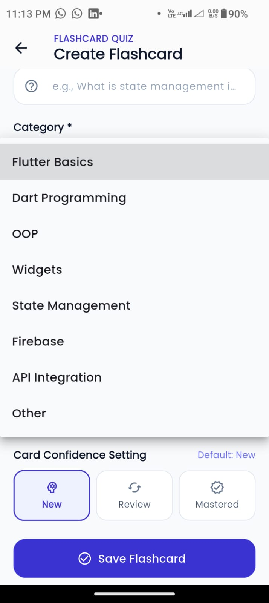
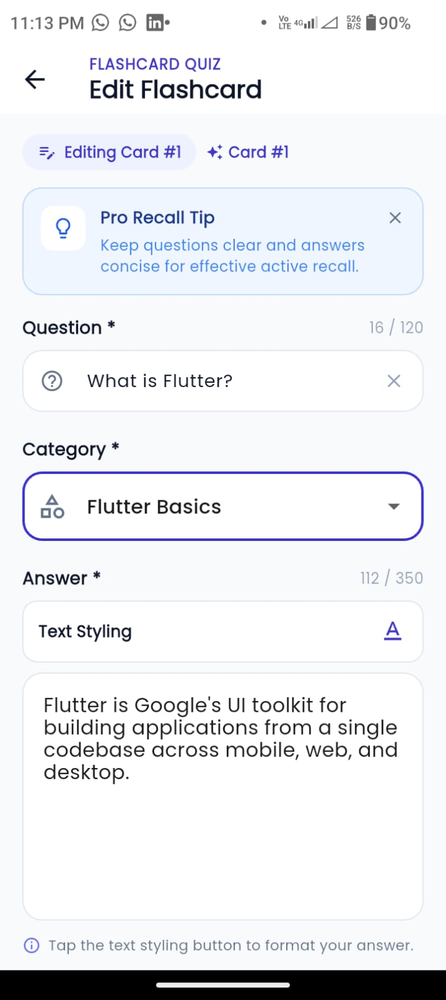
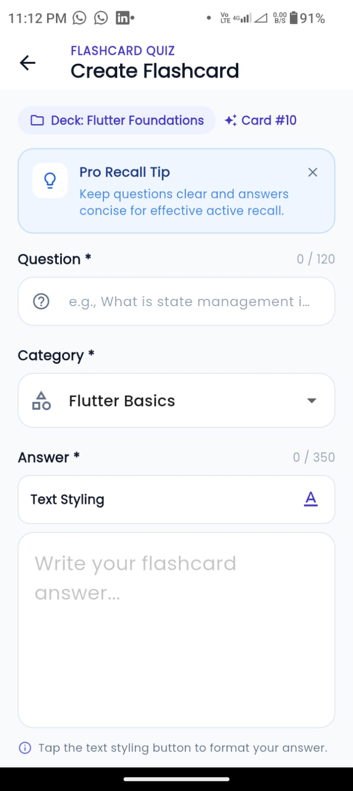

# 🧠 Flashcard Quiz App

A Flutter-based educational application designed to make learning and memorization easier through interactive flashcards, answer reveal, recall tracking, and audio pronunciation.

## ✨ Features

- **Interactive Flashcards:** Study questions and answers using an interactive flashcard interface.
- **Answer Reveal:** Show or hide answers while studying.
- **Audio Pronunciation:** Listen to word pronunciations using the built-in speaker button.
- **Recall Tracking:** Track whether you correctly remembered an answer.
- **Create Flashcards:** Add your own questions and answers.
- **Edit Flashcards:** Update existing flashcards whenever needed.
- **Delete Flashcards:** Remove flashcards you no longer need.
- **Navigation Controls:** Move between flashcards using Previous and Next buttons.
- **Local Data Storage:** Save flashcard data locally for continued learning.

## 📸 Screenshots

### Home Screen


### Interactive Flashcards


### Audio Pronunciation


### Quiz


## 🛠️ Technologies Used

- Flutter
- Dart
- Provider (State Management)
- SharedPreferences
- Flutter Quill
- Text-to-Speech
- Material Design 3
- Google Fonts (Poppins)

## 📱 Application Overview

The Flashcard Quiz App provides a simple and interactive learning environment where users can review questions, reveal answers, listen to pronunciations, and evaluate their recall.

It is designed to support self-learning and improve knowledge retention through active recall.

## 🚀 Getting Started

### Prerequisites

- Flutter SDK
- Dart SDK
- Android Studio or Visual Studio Code
- Android Emulator or Physical Android Device

### Installation

1. Clone the repository:

   ```bash
   git clone https://github.com/moaazk714/Flashcard_Quiz_app.git
   ```

2. Navigate to the project directory:

   ```bash
   cd Flashcard_Quiz_app
   ```

3. Install dependencies:

   ```bash
   flutter pub get
   ```

4. Run the application:

   ```bash
   flutter run
   ```

## 🧪 Testing

Run the following command to execute the available Flutter tests:

```bash
flutter test
```

## 🎯 Project Purpose

This project was developed as part of my **CodeAlpha Flutter Development Internship** to demonstrate practical skills in Flutter application development, state management, interactive UI design, and mobile app functionality.

## 👨‍💻 Developer

**Muhammad Moaaz**

- GitHub: [@moaazk714](https://github.com/moaazk714)
- Focus: Flutter & Dart Development

---

⭐ If you find this project useful, consider giving it a star!
